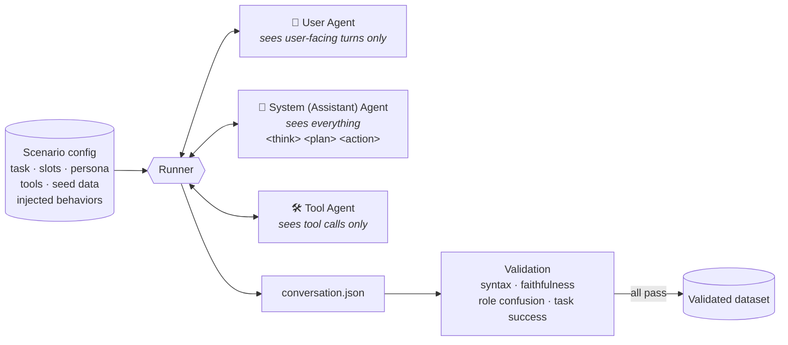

# MADS: Multi-Agent Dialog Simulation for Robust Conversational Agents

[](https://arxiv.org/abs/2610.12757)
[](LICENSE)
[](#installation)

**MADS** is a multi-agent LLM simulation pipeline that generates validated, tool-augmented, multi-turn dialogues, including the *unhappy paths* that existing function-calling benchmarks miss: users who change their minds, give partial information, or ask for the impossible, and tools that time out, return nothing, or fail.

Each generated conversation contains Pre-Act-style structured supervision for every assistant step (`<think>`, `<plan>`, `<action>`), so it can be used directly for supervised fine-tuning and RL with verifiable rewards.

📄 **Paper:** [arxiv.org/abs/2610.12757](https://arxiv.org/abs/2610.12757)

---

## Contents

- [Highlights](#highlights)
- [How It Works](#how-it-works)
- [Installation](#installation)
- [Quickstart](#quickstart)
- [The Dataset](#the-dataset)
- [Injected Behaviors (Unhappy Paths)](#injected-behaviors-unhappy-paths)
- [Running Simulations](#running-simulations)
- [Validation Pipeline](#validation-pipeline)
- [Scenario Configuration](#scenario-configuration)
- [Repository Structure](#repository-structure)
- [Citation](#citation)
- [License](#license)

---

## Highlights

| | |
|---|---|
| **Domains** | 6: Banking, Calendar, Home Services, Online Shopping, Restaurant Booking, Travel |
| **Use cases** | 17 (e.g. dispute a charge, reschedule a meeting, return an order, book a flight) |
| **Tools** | 72 domain-specific APIs with typed parameters and return schemas |
| **Scenario configs** | 105, each with seed backend data, slot constraints/preferences, and success criteria |
| **Personas** | 55, derived from [PersonaHub](https://github.com/tencent-ailab/persona-hub) |
| **Injected behaviors** | 11 types across user-side and tool-side adversities |
| **Validated conversations** | 147 released in [`data/valid_outputs/merged/`](data/valid_outputs/merged) |

---

## How It Works

Three LLM agents interact under a central runner. Each agent sees only its own view of the conversation:



- **System Agent** (the *assistant agent* in the paper): the agent being trained or evaluated. Each step emits reasoning (`<think>`), an optional plan (`<plan>`), and one action, either a tool call (`type="tool"`) or a user-facing reply (`type="say"`).
- **User Agent**: role-plays a persona with a task objective, known slot values, and optional injected behaviors. It ends the dialogue with `[DONE]` once the task is completed or abandoned.
- **Tool Agent**: emulates the domain's APIs over scenario-specific seed data, including injected failures such as timeouts, empty results, and policy rejections.

A conversation is accepted into the dataset only if it passes **all four** [validation stages](#validation-pipeline).

---

## Installation

Requires **Python 3.10+**.

```bash
git clone https://github.com/ajchakraborty/MADS.git
cd MADS
python -m venv .venv && source .venv/bin/activate
pip install -r requirements.txt
```

Create a `.env` file in the repo root with your OpenAI key (used by the agents and LLM judges):

```bash
echo "OPENAI_API_KEY=your_key_here" > .env
```

> `torch`, `transformers`, `peft`, and `accelerate` are only needed to run a local Hugging Face model as the assistant (`--hf-model`). If you only use the OpenAI API, `pip install openai pyyaml python-dotenv` is enough.

---

## Quickstart

**1. Browse a released conversation.** This needs no API key.

```bash
python src/view.py data/valid_outputs/merged/20251121_013238__os_ro_005__persona_023.json
```

**2. Validate its structure.** This needs no API key.

```bash
PYTHONPATH=src python -m eval.run \
  data/valid_outputs/merged/20251121_013238__os_ro_005__persona_023.json --syntax-only
```

**3. Simulate a new conversation and run all validators.**

```bash
python src/simulate.py ca_sm_001 --run-eval
```

**4. Generate a whole domain in parallel.**

```bash
python src/orchestrate.py data/domains/online_shopping --run-eval --parallel 4
```

---

## The Dataset

The released conversations are in [`data/valid_outputs/merged/`](data/valid_outputs/merged), one JSON file per conversation named `<timestamp>__<scenario_id>__<persona_id>.json`. [`manifest.csv`](data/valid_outputs/merged/manifest.csv) lists each file's domain, scenario, and persona.

| Domain | Conversations |
|---|---:|
| Banking | 70 |
| Online Shopping | 32 |
| Calendar Assistant | 21 |
| Restaurant Booking | 11 |
| Home Services | 10 |
| Travel | 3 |
| **Total** | **147** |

### Conversation format

```jsonc
{
  "meta":    { "conversation_id": "...", "domain_id": "online_shopping", "model": "gpt-5.1",
               "prompt_versions": { "system_agent": "v3", "user_agent": "v1", "tool_agent": "v1" } },
  "config":  { "scenario_name": "os_ro_005", "task": { ... }, "persona": { ... },
               "user_agent_config": { "injected_behaviors": [ ... ] },
               "tool_agent_config": { "context": { ... } } },
  "messages": [
    { "turn_id": 1, "role": "user", "output_raw": "hey, need to return a winter jacket ..." },
    { "turn_id": 1, "role": "assistant", "steps": [
        { "step_index": 1,
          "output_raw": "<think>...</think>\n<plan>\n1. ...\n</plan>\n<action type=\"say\">...</action>",
          "action_structured": { "type": "say", "text": "..." } }
    ] }
  ],
  "outcome": { "success": true, "reason": "user_task_complete", "total_turns": 3, "had_tool_calls": true },
  "quality": { "ok": true, "reasons": [] }
}
```

An assistant turn can contain several **steps**, for example tool call → tool result → tool call → `say`. Every step carries the raw Pre-Act output (`<action type="tool">` or `<action type="say">`) and a parsed `action_structured` whose `type` is `tool_call` or `say`.

### Loading in Python

```python
import json, glob

convs = [json.load(open(f)) for f in sorted(glob.glob("data/valid_outputs/merged/*.json"))]

for conv in convs[:1]:
    for msg in conv["messages"]:
        if msg["role"] == "user":
            print("USER:", msg["output_raw"][:80])
        else:
            for step in msg["steps"]:
                print("ASSISTANT:", step["action_structured"]["type"])
```

To summarize the whole set (domain, use case, scenario type, injected behaviors, and tool-call sequence per conversation):

```bash
python src/summarize_conversations.py --output conversation_summary.json
```

---

## Injected Behaviors (Unhappy Paths)

Behaviors are defined in [`data/catalogs/behavior_types.json`](data/catalogs/behavior_types.json) and attached per scenario to the user or tool agent.

| Type | Agent | What happens |
|---|---|---|
| `user.partial_information` | User | Knows approximate details (item, date) but not exact identifiers such as an order ID |
| `user.change_mind` | User | Changes a previously stated preference or slot value once |
| `user.invalid_input` | User | Gives an invalid value (e.g. `12:68pm`, a non-numeric party size) |
| `user.impossible_request` | User | Asks for something outside domain feasibility |
| `user.combative_user` | User | Frustrated, impatient, or passive-aggressive; may ask for a human |
| `tool.no_results` | Tool | Returns an empty result set for a valid query |
| `tool.timeout` | Tool | Transient timeout; a retry should succeed |
| `tool.server_error` | Tool | Persistent server error (e.g. HTTP 500) that does not resolve on retry |
| `tool.validation_error` | Tool | Rejects a malformed or incomplete request |
| `tool.unexpected_output` | Tool | Returns content that mismatches the query context |
| `tool.refund_window_expired` | Tool | Policy rejection: the refund window has closed |

Scenarios whose goal cannot be achieved are flagged **impossible**. For those, success means the assistant explains why and offers an alternative, not that it completes the task.

---

## Running Simulations

### `simulate.py`: one conversation

```bash
python src/simulate.py ca_sm_001 --run-eval
python src/simulate.py data/domains/calendar_assistant/schedule_meeting/ca_sm_001.json \
  --model gpt-5.1 --max-turns 20 --run-eval --verbose
```

Targets can be scenario IDs (e.g. `ca_sm_001`) or paths to scenario files. Outputs go to `data/outputs/<timestamp>__<scenario_id>__<persona_id>/`. Conversations that pass validation are also copied to `data/valid_outputs/merged/`.

<details>
<summary><b>All options</b></summary>

| Option | Description |
|---|---|
| `--model MODEL` | LLM for the agents (default: `gpt-5.1`) |
| `--user-model MODEL` | Separate LLM for the user agent |
| `--max-turns N` | Maximum conversation turns (default: 20) |
| `--run-eval` | Run validation after the conversation |
| `--eval-model MODEL` | LLM for the judges (default: `gpt-5.1`) |
| `--skip-faithfulness` | Skip the faithfulness judge |
| `--skip-role-confusion` | Skip the role-confusion judge |
| `--persona-id ID` | Override the scenario's persona |
| `--prompt-version V` | Prompt version for all agents (see `prompts/`) |
| `--system-agent-prompt-version V` | Prompt version for the system agent only (likewise `--user-…`, `--tool-…`) |
| `--outputs-root DIR` | Output directory (default: `data/outputs`) |
| `--debug-transcripts` | Also write per-agent `system.md` / `user.md` / `tool.md` |
| `--export-steps-jsonl` | Export per-step traces to `turns.jsonl` |
| `--api-key KEY` | OpenAI key (otherwise read from `.env`) |
| `--verbose`, `-v` | Verbose console output |

</details>

### `orchestrate.py`: many conversations

```bash
python src/orchestrate.py ca_sm_001 ca_rm_002                  # by scenario ID
python src/orchestrate.py data/domains/online_shopping/return_order  # one use case
python src/orchestrate.py data/domains/calendar_assistant       # one domain
python src/orchestrate.py data/domains --parallel 4 --run-eval  # everything
```

<details>
<summary><b>All options</b></summary>

| Option | Description |
|---|---|
| `--parallel N` | Run N scenarios concurrently (default: 1) |
| `--dry-run` | List what would run without calling any model |
| `--use-case NAME` | When the target is a domain, run only this use case |
| `--run-eval`, `--model`, `--max-turns`, `--eval-model`, `--skip-*`, `--persona-id`, `--verbose` | Passed through to `simulate.py` |

A summary JSON with success rates, eval results, and timing is written to `data/outputs/`.

</details>

### Using a fine-tuned Hugging Face model as the assistant

```bash
python src/simulate.py ca_sm_001 \
  --hf-model <your-hf-model-or-lora> \
  --hf-base-model Qwen/Qwen2.5-7B-Instruct   # only if --hf-model is a LoRA adapter
```

Use `--hf-tokenizer` to load the tokenizer from a different checkpoint (e.g. the SFT model when running an RL checkpoint). Use `--no-4bit` on machines without CUDA.

### Viewing conversations

```bash
python src/view.py path/to/conversation.json              # system view (everything)
python src/view.py path/to/conversation.json --as user    # what the user agent saw
python src/view.py path/to/conversation.json --as tool    # what the tool agent saw
python src/view.py path/to/conversation.json --to-file    # write markdown
```

---

## Validation Pipeline

```bash
PYTHONPATH=src python -m eval.run path/to/conversation.json            # all four stages
PYTHONPATH=src python -m eval.run path/to/conversation.json --syntax-only   # rule-based only, no API calls
```

| Stage | Type | Checks |
|---|---|---|
| **Syntax** (`eval.syntax`) | Rule-based | Every step has `<think>`; the first step of a turn has `<plan>`; each turn ends with exactly one `say`; tool calls match their schema (name, required params, types) |
| **Faithfulness** (`eval.faithfulness`) | LLM judge | Tool arguments are grounded in what the user said; `say` replies do not contradict or invent tool results |
| **Role confusion** (`eval.role_confusion`) | LLM judge | The user agent stays in character and never acts like the assistant |
| **Task success** (`eval.success`) | LLM judge | The goal is met under hard constraints (soft preferences may be relaxed); for impossible scenarios, a graceful explanation plus an alternative |

Each stage can also be run on its own, e.g. `PYTHONPATH=src python -m eval.success.cli conversation.json --model gpt-5.1`. Judge models are set with `--model`, `--faithfulness-model`, and `--role-confusion-model`.

---

## Scenario Configuration

Each scenario is a JSON file under `data/domains/<domain>/<use_case>/`, and each domain shares one `tools.json`:

```jsonc
{
  "metadata":   { "domain": "calendar_assistant", "use_case": "schedule_meeting", "scenario_id": "ca_sm_001" },
  "domain_ref": { "toolset_path": "../tools.json" },
  "task": {
    "objective": "Schedule a meeting with Sarah next week",
    "slots": {
      "constraints": { "attendees": ["sarah.chen@uoregon.edu"], "duration_minutes": 60 },  // must hold
      "preferences": { ... }                                                               // may be relaxed
    },
    "success_criteria": {
      "target_selector": { "attendees": ["sarah.chen@uoregon.edu"] },  // which seed entities to act on
      "action": "create_meeting",                                      // required tool call
      "notes": "Success if the assistant schedules a 60-minute meeting with Sarah."
    }
  },
  "user_agent": { "injected_behaviors": [ { "type_id": "user.change_mind", "instructions": "..." } ] },
  "tool_agent": { "context": { "seed": { "events": [ ... ], "available_slots": [ ... ] } } },
  "persona": "persona_002"
}
```

- **Slots** describe what the user wants. **Seed data** is the backend state the tool agent serves. The assistant has to use tools to bridge the two.
- **Success criteria** tell the success judge which entities to act on (`target_selector`) and which tool must be called (`action`). Without them, the judge infers success from `objective` and `slots`.

More detail:
- [`docs/scenario_schema_guide.md`](docs/scenario_schema_guide.md): the full slot and success-criteria schema
- [`docs/failure_investigation_guide.md`](docs/failure_investigation_guide.md): how to debug failed simulations
- [`docs/common_issues_by_domain.md`](docs/common_issues_by_domain.md): known pitfalls per domain

---

## Repository Structure

```
MADS/
├── src/
│   ├── simulate.py               # run one conversation
│   ├── orchestrate.py            # run many (parallel, dry-run)
│   ├── runner.py                 # turn-taking and termination
│   ├── agents.py                 # system / user / tool agents
│   ├── core.py                   # LLM clients (OpenAI, Hugging Face)
│   ├── scenario.py               # scenario + persona loading
│   ├── view.py                   # perspective-aware viewer
│   ├── summarize_conversations.py
│   ├── eval/                     # syntax, faithfulness, role_confusion, success
│   └── Pre_Act_Sft (3).ipynb     # SFT / evaluation notebook
├── prompts/
│   ├── system_agent/             # v1, v2, v3
│   ├── user_agent/               # v1
│   └── tool_agent/               # v1
├── data/
│   ├── domains/                  # 6 domains: tools.json + scenario configs
│   ├── personas/                 # 55-persona catalog + PersonaHub sources
│   ├── catalogs/                 # injected behavior types
│   └── valid_outputs/merged/     # 147 validated conversations + manifest.csv
└── docs/
```

---

## Acknowledgments

This work was carried out as an academic collaboration between the **University of California, Santa Cruz (UCSC)** and **Uniphore**.

We are grateful to the UCSC authors **Adam Zernik**, **Ishika Kulkarni**, **Mudit Arora**, and **Hugo Lin** for their contributions to this work.

---

## Citation

If you use MADS or MADS-Bench in your research, please cite:

```bibtex
@misc{chakraborty2026madsmultiagentdialogsimulation,
      title={MADS: Multi-Agent Dialog Simulation for Robust Conversational Agents}, 
      author={Arkajyoti Chakraborty and Adam Zernik and Ishika Kulkarni and Mudit Arora and Hugo Lin and Justin Chiu and Alessandro Di Bari and Neha Gupta and Andreas Stolcke},
      year={2026},
      eprint={2610.12757},
      archivePrefix={arXiv},
      primaryClass={cs.CL},
      url={https://arxiv.org/abs/2610.12757}, 
}
```

## License

Released under the [Apache License 2.0](LICENSE).
